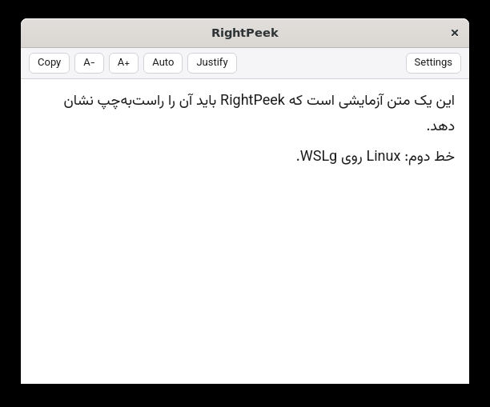

# RightPeek

**English** · [فارسی](README.fa.md)

Select text in any app, press a shortcut, and read it with correct
right-to-left layout.

RightPeek is a tiny tray app for Windows and Linux. Persian, Arabic and Hebrew
text that other apps show scrambled, especially when it is mixed with English
words, numbers and parentheses, opens in a clean viewer laid out the way it
should be.



## Features

- **One shortcut, any app.** Select text and press **Ctrl+Shift+Space**
  (configurable).
- **Correct direction per paragraph.** Each paragraph is laid out right-to-left
  or left-to-right by the majority of its words, so a Persian paragraph that
  starts with an English term still reads correctly.
- **Faithful text.** The zero-width non-joiner (نیم‌فاصله) is kept; Arabic
  presentation forms copied from PDFs are turned back into normal letters.
- **Viewer tools.** Copy, font size (Ctrl + / Ctrl −), force RTL or LTR,
  justify, light and dark theme. Esc closes it.
- **Leaves your clipboard alone.** On Windows the clipboard is restored after
  reading and nothing lands in the Win+V history; on Linux the selection is
  read directly and the clipboard is never touched.
- **Light.** Lives in the tray, uses no CPU while idle, and opens the viewer
  only when needed. The installer is under 2 MB.
- **Private.** No network access, no telemetry. Captured text is never written
  to disk or logs.

## Download

Get the files from the [Releases](../../releases) page:

| System | File |
|---|---|
| Windows 10 / 11, installer | `RightPeek_<version>_x64-setup.exe` |
| Windows, portable | `RightPeek_<version>_x64-portable.exe` |
| Debian / Ubuntu | `RightPeek_<version>_amd64.deb` |
| Fedora / openSUSE | `RightPeek-<version>-1.x86_64.rpm` |

## Install

### Windows

Run `RightPeek_<version>_x64-setup.exe`. It installs for the current user only,
so no administrator rights are needed. If the Microsoft Edge WebView2 runtime
is missing (Windows 11 always has it), the installer downloads it.

The files are not code-signed yet, so Windows SmartScreen may say "Windows
protected your PC". Click **More info → Run anyway**.

**Portable:** `RightPeek_<version>_x64-portable.exe` runs without installing.
It needs WebView2 already present, has no Start menu entry or uninstaller, and
keeps its settings in `%APPDATA%\com.rightpeek.app`. Turn off "Start
RightPeek when you sign in" before deleting or moving the exe.

### Linux

```bash
sudo apt install ./RightPeek_<version>_amd64.deb
```

```bash
sudo dnf install ./RightPeek-<version>-1.x86_64.rpm
```

The package manager pulls in WebKitGTK 4.1. Packages are built on Ubuntu 22.04
and work on newer Debian, Ubuntu and Fedora releases. On Wayland, also install
`wl-clipboard` (the `.deb` recommends it).

## Use

1. Select text in any app.
2. Press **Ctrl+Shift+Space**.
3. Read it in the viewer.

On the first start RightPeek opens its Settings window so you can see it is
running. There you can change the shortcut, start RightPeek when you sign in,
and choose to start quietly in the tray. Open Settings again from the tray icon
or from the viewer.

**Wayland (Linux):** global shortcuts only work while an X11 app has focus.
Add a keyboard shortcut in your desktop settings (GNOME: Settings → Keyboard →
Custom Shortcuts; KDE: System Settings → Shortcuts) that runs
`rightpeek --show`. The Settings window shows the exact command.

**Limits:** Windows does not let normal apps read windows that run as
administrator. Some Linux apps keep the last selection after you deselect it,
so RightPeek shows that text.

## Uninstall

- **Windows:** Settings → Apps → Installed apps → RightPeek → Uninstall. This
  also removes the "start when you sign in" entry. Tick "Delete the application
  data" to remove settings and logs too.
- **Linux:** `sudo apt remove right-peek` or `sudo dnf remove right-peek`. This
  also removes the "start when you sign in" entry. Settings and logs stay in
  `~/.local/share/com.rightpeek.app`; delete that folder to remove them.

## Privacy

RightPeek does not connect to the internet and collects no data. Captured text
stays in memory only. The optional log file (off by default) records events
and errors, never text. The only network access is the Windows installer
downloading WebView2 from Microsoft when it is missing.

| | Settings | Logs |
|---|---|---|
| Windows | `%APPDATA%\com.rightpeek.app` | `%LOCALAPPDATA%\com.rightpeek.app\logs` |
| Linux | `~/.local/share/com.rightpeek.app` | `~/.local/share/com.rightpeek.app/logs` |

## Build from source

Requirements: Rust (stable), Node.js 20, and the Tauri 2 prerequisites:
WebView2 and the MSVC build tools on Windows; on Debian/Ubuntu
`libwebkit2gtk-4.1-dev libayatana-appindicator3-dev librsvg2-dev libxdo-dev libssl-dev`.

```bash
npm ci
npm run tauri build
```

Packages are written to `src-tauri/target/release/bundle/`. The design is in
[`docs/PLAN.md`](docs/PLAN.md) and the release process in
[`docs/release.md`](docs/release.md).
