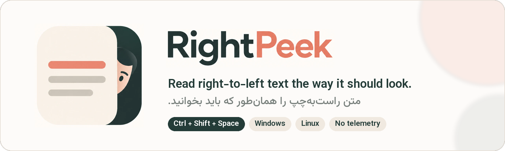
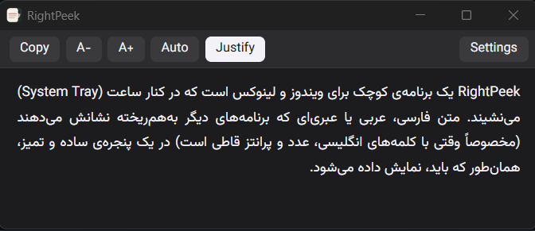

**English** · [فارسی](README.fa.md)

Select text in any app, press a shortcut, and read it with correct
right-to-left layout. For Windows, Linux and macOS.

Persian, Arabic and Hebrew text that other apps show scrambled, especially
when it is mixed with English words, numbers and parentheses, opens in a
clean viewer laid out the way it should be.

## Features

- **One shortcut, any app.** Select text and press **Ctrl+Shift+Space**
  (**Cmd+Shift+Space** on macOS; configurable). On macOS also from the
  right-click menu: **Services → Show in RightPeek**.
- **Correct direction per paragraph.** Each paragraph is laid out right-to-left
  or left-to-right by the majority of its words, so a Persian paragraph that
  starts with an English term still reads correctly. A number right after an
  English word stays with the Persian text it belongs to ("CPU، ۲ گیگابایت").
- **Faithful text.** The zero-width non-joiner (نیم‌فاصله) is kept; Arabic
  presentation forms copied from PDFs are turned back into normal letters.
- **Viewer tools.** Copy, simple editing of the text (Edit; Esc when done),
  font size (Ctrl + / Ctrl −), force RTL or LTR, justify. Light or dark theme
  follows the system or is chosen in Settings. Esc closes it.
- **Leaves your clipboard alone.** On Windows the clipboard is restored after
  reading and nothing lands in the Win+V history; on Linux the selection is
  read directly and the clipboard is never touched. On macOS most apps are
  read through Accessibility; elsewhere RightPeek copies and then restores
  the clipboard.
- **Light.** Lives in the tray (the menu bar on macOS), uses almost no CPU
  while idle, and opens the viewer only when needed. Downloads are under 5 MB.
- **Private.** No network access, no telemetry. Captured text is never written
  to disk or logs.

## Example

```
RightPeek یک برنامه‌ی کوچک برای ویندوز، لینوکس و مک است که در کنار ساعت (System Tray) می‌نشیند. متن فارسی، عربی یا عبری‌ای که برنامه‌های دیگر به‌هم‌ریخته نشانش می‌دهند (مخصوصاً وقتی با کلمه‌های انگلیسی، عدد و پرانتز قاطی است) در یک پنجره‌ی ساده و تمیز، همان‌طور که باید، نمایش داده می‌شود.
```

<p align="center">
  
</p>

## Download

Get the files from the [latest release](../../releases/latest):

| System | File |
|---|---|
| Windows 10 / 11, installer | `RightPeek_<version>_x64-setup.exe` |
| Windows, portable | `RightPeek_<version>_x64-portable.exe` |
| Debian / Ubuntu / Linux Mint | `RightPeek_<version>_amd64.deb` |
| Fedora | `RightPeek-<version>-1.x86_64.rpm` |
| macOS 11 or newer, Apple Silicon (M1 and later) | `RightPeek_<version>_aarch64.dmg` |

To check a download, compare its SHA-256 with `SHA256SUMS.txt` from the same
release: `sha256sum -c SHA256SUMS.txt --ignore-missing` on Linux,
`shasum -a 256 -c SHA256SUMS.txt --ignore-missing` on macOS, or
`Get-FileHash <file>` in PowerShell on Windows.

## Install

### Windows

Run `RightPeek_<version>_x64-setup.exe`. It installs for the current user only,
so no administrator rights are needed. If the Microsoft Edge WebView2 runtime
is missing (Windows 11 always has it), the installer downloads it.

The files are not code-signed yet, so Windows SmartScreen may say "Windows
protected your PC". Click **More info → Run anyway**.

**Portable:** `RightPeek_<version>_x64-portable.exe` runs without installing.
It needs WebView2 already present, has no Start menu entry or uninstaller, and
keeps its settings in `%APPDATA%\com.rightpeek.app`. Turn off "Start
RightPeek when you sign in" before deleting or moving the exe.

### Linux

```bash
sudo apt install ./RightPeek_<version>_amd64.deb
```

```bash
sudo dnf install ./RightPeek-<version>-1.x86_64.rpm
```

The package manager pulls in WebKitGTK 4.1. On Wayland, also install
`wl-clipboard` (the `.deb` recommends it).

**Supported versions (64-bit x86):** Ubuntu 22.04, Linux Mint 21, Debian 12,
Fedora 39 or newer. Older releases such as Ubuntu 20.04, Linux Mint 20 and
Debian 11 have no WebKitGTK 4.1, so apt reports
`libwebkit2gtk-4.1-0 but it is not installable`; upgrade the system first.

### macOS

Open the `.dmg` and drag **RightPeek** to **Applications**. The app is not
notarized by Apple yet, so the first time macOS says it cannot check it for
malware. Click **Done**, then open **System Settings → Privacy & Security**,
scroll down and click **Open Anyway** next to the RightPeek message. RightPeek
lives in the menu bar; it has no Dock icon.

**Allow Accessibility.** The shortcut reads the selection through macOS
Accessibility. On the first use macOS asks for it; or open RightPeek
Settings and click **Open System Settings**, then turn on RightPeek under
**Privacy & Security → Accessibility**. After installing a new version,
remove RightPeek from that list (−) and add it again if the shortcut says
"Permission needed". The right-click **Services → Show in RightPeek** entry
works without this permission.

## Use

1. Select text in any app.
2. Press **Ctrl+Shift+Space** (**Cmd+Shift+Space** on macOS).
3. Read it in the viewer.

On the first start RightPeek opens its Settings window so you can see it is
running. There you can change the shortcut, pick the theme, start RightPeek
when you sign in, and choose to start quietly in the tray. Open Settings
again from the tray icon or from the viewer.

**Wayland (Linux):** on KDE Plasma and GNOME 48 or later the desktop manages
the shortcut and may ask you to confirm it once. On older GNOME (such as
Ubuntu 24.04) RightPeek adds the shortcut to Settings → Keyboard → Custom
Shortcuts itself and updates it when you change it. On other Wayland
desktops the shortcut only works while an X11 app has focus: add a keyboard
shortcut in your desktop settings that runs `rightpeek --show`. The Settings
window says which case applies and shows the exact command when you need it.

**macOS:** besides the shortcut, select text, right-click and choose
**Services → Show in RightPeek**. Apps with their own context menus (VS Code,
Telegram) do not list Services there; use the app menu (e.g. Code → Services)
or give the service a shortcut in System Settings → Keyboard → Keyboard
Shortcuts → Services.

**Limits:** Windows does not let normal apps read windows that run as
administrator. Some Linux apps keep the last selection after you deselect it,
so RightPeek shows that text. On macOS, apps without Accessibility text
(browsers, Electron apps) are read by a quick copy; a clipboard manager may
record that text.

## Uninstall

- **Windows:** Settings → Apps → Installed apps → RightPeek → Uninstall. This
  also removes the "start when you sign in" entry. Tick "Delete the application
  data" to remove settings and logs too.
- **Linux:** `sudo apt remove right-peek` or `sudo dnf remove right-peek`. This
  also removes the "start when you sign in" entry. Settings and logs stay in
  `~/.local/share/com.rightpeek.app`; delete that folder to remove them. On
  GNOME, also remove the RightPeek entry from Settings → Keyboard → Custom
  Shortcuts.
- **macOS:** turn off "Start RightPeek when you sign in" in Settings, quit
  RightPeek from the menu bar and move it from Applications to the Trash. To
  remove settings and logs too, delete
  `~/Library/Application Support/com.rightpeek.app` and
  `~/Library/Logs/com.rightpeek.app`. If the app is already gone, delete
  `~/Library/LaunchAgents/RightPeek.plist` to stop the sign-in entry.

## Privacy

RightPeek does not connect to the internet and collects no data. Captured text
stays in memory only. The optional log file (off by default) records events
and errors, never text. The only network access is the Windows installer
downloading WebView2 from Microsoft when it is missing.

| | Settings | Logs |
|---|---|---|
| Windows | `%APPDATA%\com.rightpeek.app` | `%LOCALAPPDATA%\com.rightpeek.app\logs` |
| Linux | `~/.local/share/com.rightpeek.app` | `~/.local/share/com.rightpeek.app/logs` |
| macOS | `~/Library/Application Support/com.rightpeek.app` | `~/Library/Logs/com.rightpeek.app` |

## Build from source

Requirements: Rust (stable), Node.js 20, and the Tauri 2 prerequisites:
WebView2 and the MSVC build tools on Windows; on Debian/Ubuntu
`libwebkit2gtk-4.1-dev libayatana-appindicator3-dev librsvg2-dev libxdo-dev libssl-dev`;
on macOS the Xcode Command Line Tools (`xcode-select --install`).

```bash
npm ci
npm run tauri build
```

Packages are written to `src-tauri/target/release/bundle/`.

## Documentation

- [Design](docs/design.md): goals, budgets, architecture, how each platform
  reads the selection, and the RTL rules of the viewer.
- [Development](docs/development.md): building, checks, test scripts and
  platform notes.
- [Capture matrix](docs/capture-matrix.md): results per app and platform.
- [Budgets](docs/budgets.md): measured memory, speed and size.
- [Release process](docs/release.md).

## License

[MIT](LICENSE) © Aydin Kazemi
